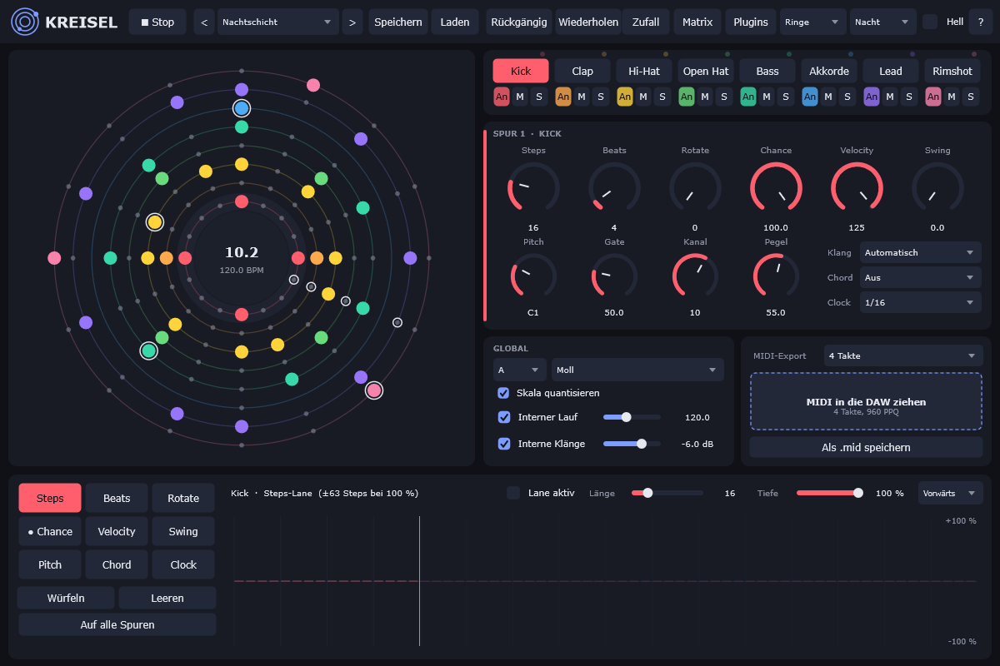
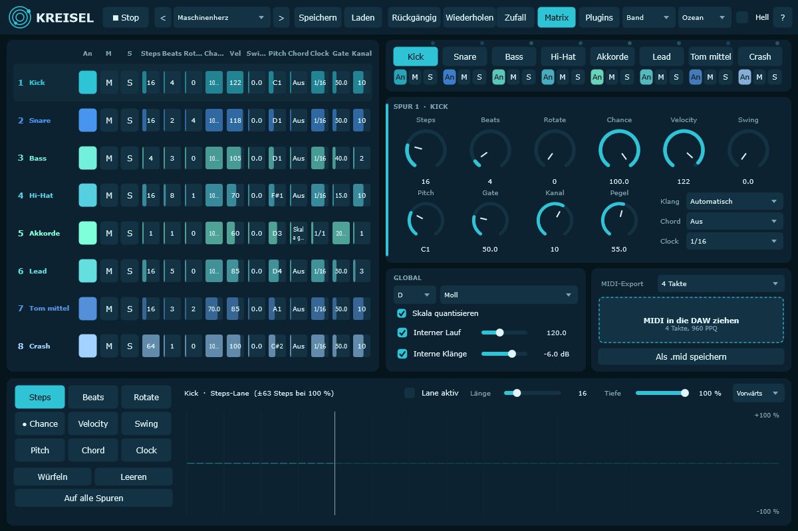
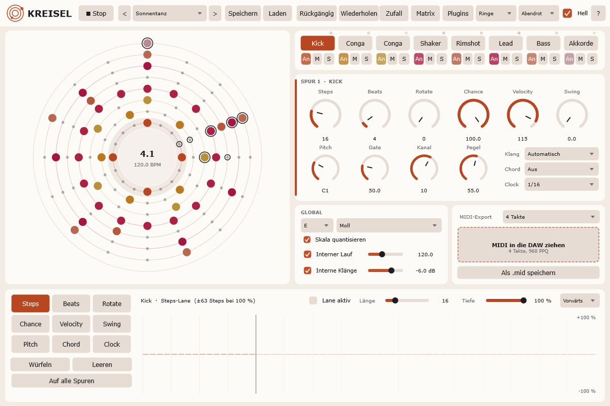

# Kreisel – euklidischer MIDI-Sequencer (VST3 / Standalone)

Acht euklidische Spuren mit eigenem Takt und eigener Länge, 72 Modulations-Lanes, Skalen & Akkorde,
Zufallsgenerator mit Min/Max-Bereichen, MIDI-Export per Drag & Drop (960 PPQ), neun Darstellungen,
sechs Farbthemen (dunkel/hell), 40 Undo-Schritte, eingebaute Klänge und VST3-Plugins pro Spur.
Läuft als VST3 in jeder DAW oder als eigenständiges Programm.



## Download
Windows-Installer (VST3 + Standalone): **[Releases](https://github.com/Yakobo1970/Kreisel/releases/latest)** –
`Kreisel-<Version>-Setup.exe` ausführen; das VST3 landet in `C:\Program Files\Common Files\VST3`.
Projektseite: https://www.undabtanzbar.de/software/kreisel/

| Matrix-Ansicht | Helles Thema |
|---|---|
|  |  |

## Funktionen
- **Spuren (8):** Aktiv/Stumm/Solo, Steps 1–64, Beats, Rotate, Chance, Velocity, Swing, Pitch, Chord, Clock (4/1 … 1/64 inkl. punktiert/triolisch), Gate 5–200 %, MIDI-Kanal 1–16
- **Modulation:** je Spur 9 Lanes (Steps, Beats, Rotate, Chance, Velocity, Swing, Pitch, Chord, Clock), 2–64 Schritte, vorwärts/rückwärts/Ping-Pong/zufällig, Tiefe; zeichnen mit der Maus, würfeln, leeren, auf alle Spuren kopieren
- **Tonart:** Grundton + 16 Skalen, Quantisierung (Pitch-Lane läuft dann in Skalenstufen), 18 Akkordtypen inkl. diatonischer Skalen-Akkorde
- **Zufall:** pro Parameter an/aus + Min/Max, gewählte Spur oder alle aktiven Spuren
- **MIDI-Export:** 1/2/4/8/16 Takte, 960 PPQ, Typ-1-Datei mit einer Spur pro Sequencer-Spur – Feld in die DAW ziehen oder als .mid speichern
- **Ansichten:** Band, Ringe, Polygon, Speichen, Raster, Puls, Spirale, Dichte, Blüte + Matrix-Tabelle aller Spuren
- **Presets:** 214 Werks-Presets in 26 Genres + „Demos“ (Menü mit Untermenüs): Techno, Minimal & Tech House, House, Trance, Progressive, Psytrance, Drum & Bass, Breakbeat & Garage, Dubstep & Bass, Hard Dance, Dark Electro & EBM, Industrial, Synthwave, Hip Hop, Trap, Lofi, Chill & Downtempo, Ambient, Pop, Indie & Rock, Funk & Disco, Afro & Latin, Reggae & Dub, Jazz & Soul, IDM & Experimental, Cinematic. Ganz unten „Demos“: zwölf längere Stücke, die alle acht Spuren und viele Lanes nutzen und sich über Minuten weiterentwickeln. Drums auf Kanal 10 (GM), Akkorde/Flächen Kanal 1, Bass Kanal 2, Lead/Arp Kanal 3. Tempo kommt aus der DAW – Genre-typisches Tempo selbst einstellen. Eigene Presets in `Dokumente\Kreisel\Presets\*.kreisel`.
- **Eingebaute Klänge:** synthetisches Drum-Kit (GM-Belegung auf Kanal 10: Kick, Snare, Clap, Rim, Hi-Hats mit Choke, Toms, Becken, Cowbell, Perkussion, Shaker …) und Synth-Stimmen (Acid-Bass, Sub-Bass, Saw-/Square-Lead, Pluck, Fläche, Keys, Glocke, Orgel). Pro Spur „Klang“ (Automatisch = nach MIDI-Kanal) und „Pegel“, global „Interne Klänge“ + Lautstärke. MIDI wird weiterhin parallel ausgegeben. Ältere Projekte laden mit ausgeschalteten internen Klängen.
- **Spurnamen:** automatisch aus Klang, GM-Drum-Note oder Kanal (Kick, Hi-Hat, Bass, Lead, Akkorde …), Doppelklick/Rechtsklick auf den Tab benennt um; eigene Namen werden in Projekt und eigenen Presets gespeichert.
- **Standalone:** startet mit „Interner Lauf“ und spielt die eingebauten Klänge.
- **VST3-Plugins pro Spur:** Kopfzeile „Plugins“ → Ordner eintragen und scannen (Liste in `%APPDATA%\Kreisel\Kreisel.settings`, gilt für alle Instanzen). Rechtsklick auf einen Spur-Tab lädt ein Instrument (ersetzt den eingebauten Klang) und einen Effekt; Fenster öffnen/entfernen im selben Menü. Plugins samt Einstellungen werden im Projekt gespeichert. Funktioniert im Plugin und in der Standalone.
- **Lupe:** Rechtsklick irgendwo (außer Spur-Tabs und Lanes) – Vergrößerung 2–4×, drei Größen.
- **Icon:** `Resources/icon.png`, erzeugt mit `Tools/make_icon.py`.
- **Tests:** zusätzlich `UiShot hosttest <instrument.vst3> <effekt.vst3>` (lädt, spielt, speichert und stellt Plugins wieder her).
- **Preset-Bibliothek erweitern:** `Source/PresetLib*.inc`, kompaktes Textformat (Beschreibung in `Presets.cpp`); `EngineTest` prüft jedes Preset.
- **Quantisierung:** Spuren auf MIDI-Kanal 10 (Drums) werden nie auf die Skala gezogen.
- **Sync:** folgt dem DAW-Transport (PPQ-genau, Loops/Sprünge), sonst „Interner Lauf“ mit eigenem Tempo
- Alle 117 Spur-/Global-Parameter sind automatisierbar; eingebaute Hilfe über „?“

## Bauen
```
cmake -B build -G "Visual Studio 18 2026" -A x64
cmake --build build --config Release --target Kreisel_VST3 Kreisel_Standalone
```
JUCE wird unter `%USERPROFILE%\JUCE` erwartet (`-DJUCE_DIR=…` zum Überschreiben).

## Tests
- `EngineTest` – Euklid-Muster, Blockgrößen-Unabhängigkeit, Swing, Akkorde, Lanes, alle Presets, MIDI-Export
- `HostTest <Kreisel.vst3>` – lädt das VST3 wie eine DAW: MIDI-Ausgabe, Stopp/Loop ohne hängende Noten, State-Round-Trip
- `UiShot <out.png> [ansicht] [thema] [hell] [preset] [matrix|random|help] [ppq]` – rendert den Editor als PNG; `UiShot undotest` prüft Undo

## Herkunft & Lizenz
Kreisel ist inspiriert von euklidischen Sequencern wie ADSR Orbit, ist aber eigenständig geschrieben
(eigener Code, eigene Grafik, eigene Presets) und steht in keiner Verbindung zu ADSR Sounds.
Eigener Code: MIT-Lizenz (siehe `LICENSE`). Gebaut mit [JUCE](https://juce.com); VST ist eine Marke der Steinberg Media Technologies GmbH.

Kostenlos – wer mag, kann per [PayPal](https://paypal.me/yakobo) etwas spenden.
Kay „Yakobo“ Fiedler · https://www.undabtanzbar.de · https://github.com/Yakobo1970
